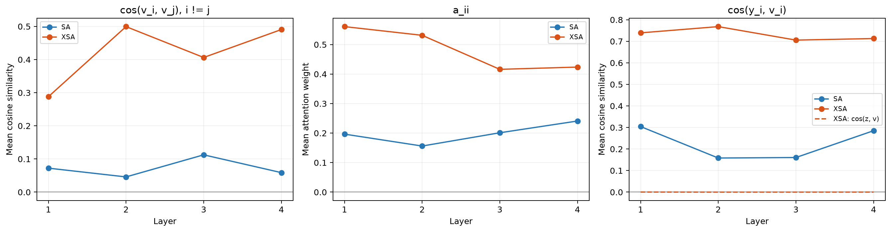
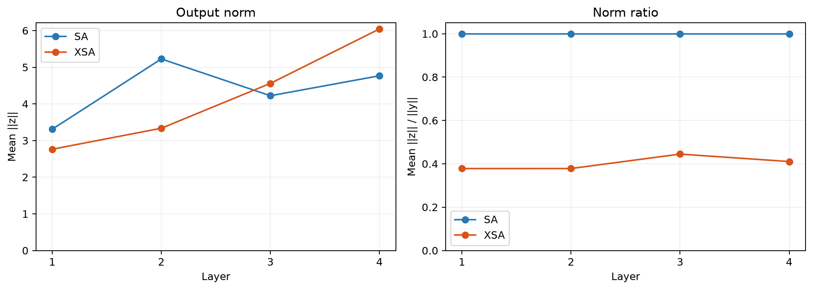

## Setup

Для постановки экспериментов написал небольшую библиотеку на основе nanoGPT (как и в воспроизводимой статье) и [pytorch_project_template](https://github.com/Blinorot/pytorch_project_template). Такое решение позволяет более удобно ставить эксперименты за счёт большой конфигурируемости.

Дополнительно проверил, что моё решение примерно соответствует nanoGPT: по моим замерам loss отличается на ~0.01 от бейзлайна с обучением nanoGPT на CPU на Shakespeare char.

В связи с отсутствием GPU решил все эксперименты ставить на MPS (по моим замерам, ~1.5x быстрее, чем CPU).

В качестве бейзлайна использовал небольшой GPT: 4 слоя, hidden dim 128, 4 головы, контекст 64 символа, dropout 0. Обучал на Shakespeare с char-токенизацией, batch size 12, 2000 шагов. Оптимизатор — AdamW, scheduler — OneCycleLR. Для сравнения SA и XSA добавил RoPE и LayerNorm после эмбеддингов, как в статье.

Для трекинга экспериментов использовал wandb, вот ссылка на эксперименты: https://forge.coreweave.com/wandb/ivanboboshko888-hse-university4375/baby-gpt?nw=nwuserivanboboshko888.

## Эксперименты

В таблицах — val loss в конце обучения на всей валидации. LR — пиковый learning rate, std — выборочное стандартное отклонение по трём seed.

### SA vs XSA

Сначала сравнил SA и XSA с дефолтным LR `1e-3`. Контекст 64, batch size 12, 2000 шагов. Здесь результаты перепрогона первого эксперимента на всей валидации.

| Seed | SA | XSA |
|---|---:|---:|
| 1337 | 1.8224 | 1.8709 |
| 42 | 1.7945 | 1.8772 |
| 228 | 1.8156 | 1.8518 |
| Среднее ± std | 1.8108 ± 0.0146 | 1.8666 ± 0.0132 |

### Длина контекста

Затем проверил контексты 64, 128 и 256. При увеличении контекста уменьшал batch size, чтобы оставить 768 токенов на шаг. Все запуски по 2000 шагов, LR `1e-3`, seed 1337.

| Контекст | Batch size | SA | XSA |
|---|---:|---:|---:|
| 64 | 12 | 1.8224 | 1.8540 |
| 128 | 6 | 1.8137 | 1.8703 |
| 256 | 3 | 1.8325 | 1.8802 |

Увеличение контекста тоже не помогло XSA обойти SA.

Здесь и в подборе LR использовались отдельные запуски, поэтому значения при одинаковых настройках немного отличаются.

### Подбор LR

После этого проверил, изменится ли результат при другом LR. Для SA и XSA попробовал пиковые значения `3e-4`, `1e-3` и `3e-3`. Контекст 64, batch size 12, 2000 шагов, seed 1337.

| LR | SA | XSA |
|---|---:|---:|
| 3e-4 | 2.0355 | 2.0342 |
| 1e-3 | 1.8224 | 1.8638 |
| 3e-3 | 1.7421 | 1.8361 |

Для обеих моделей лучший из проверенных LR — `3e-3`.

Затем повторил сравнение с `3e-3` на seed 42 и 228. По трём seed получилось **1.7330 ± 0.0094 у SA** и **1.8053 ± 0.0274 у XSA**. SA снова лучше на каждом seed.

### Проверка активаций и train loss

Дополнительно посмотрел активации в [ноутбуке](../attention_sim_bias.ipynb). Взял лучшие чекпоинты SA и XSA с LR `3e-3`, seed 228. Сравнивал на одинаковых 1024 случайных train-окнах.

У XSA до проекции выше и similarity, и диагональные веса attention. После проекции `cos(z, v)` почти нулевой на всех слоях, то есть операция работает как ожидается.

После проекции у XSA остается в среднем 38–44% нормы исходного выхода. При этом абсолютная норма `z` сопоставима с SA, то есть выход не схлопывается. Нормы считал отдельно по головам, до выходного линейного слоя.

## Вывод

Получилось реализовать XSA, но улучшение из статьи воспроизвести не удалось. SA лучше на трёх seed-ах с дефолтным и лучшим проверенным LR. Увеличение контекста до 256 символов тоже не помогло.

Возможно, дело в масштабе и данных: у меня `baby` GPT на char Shakespeare и 2000 шагов, а в статье — модели от 0.7B на FineWeb с GPT-2 токенизацией и гораздо большим бюджетом. Маленькой модели может быть сложнее компенсировать удаление компоненты вдоль собственного value через FFN.
